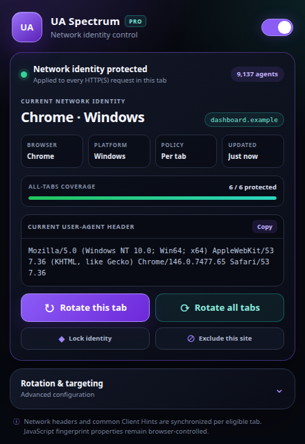
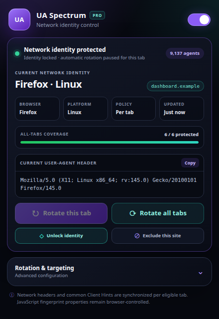
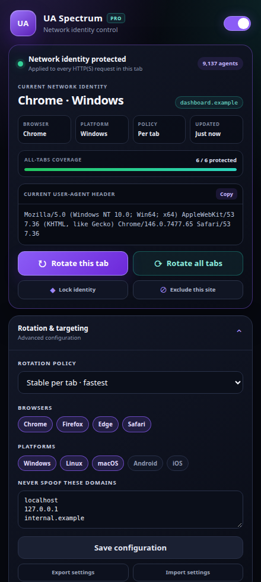

<div align="center">

  

  # UA Spectrum

  **Professional per-tab User-Agent control for Chromium.**

  [](manifest.json)
  [](manifest.json)
  [](#identity-catalog)
  [](#privacy)

  [Features](#features) · [Install](#installation) · [Use](#usage) · [Limits](#important-browser-limit) · [Documentation](#documentation)

</div>

---

## Overview

UA Spectrum is a local Chromium Manifest V3 extension that assigns a realistic
network User-Agent identity to each eligible browser tab. It supports controlled
rotation, per-tab identity locking, instant current-site exclusions, synchronized
low-entropy Client Hints, and all-tab health repair.

It is intended for authorized browser testing, compatibility checks, and privacy
experiments. It does not claim to provide a complete anti-fingerprinting boundary.

## Screenshots

| Live protection dashboard | Locked tab identity |
|---|---|
|  |  |

### Rotation and targeting

<p align="center">
  
</p>

## Features

- **Per-tab isolation:** each eligible HTTP(S) tab receives its own DNR rule.
- **9,137 identities:** Chrome, Edge, Firefox, and Safari across desktop and mobile platforms.
- **Five rotation policies:** navigation, focus, stable per tab, 30 seconds, or 5 minutes.
- **Identity lock:** preserve a chosen tab identity during automatic and all-tab rotation.
- **Current-site control:** exclude or include the active hostname with one click.
- **Batch operations:** apply and rotate all tab rules in one DNR update.
- **Health repair:** restore only missing or stale rules without disturbing healthy tabs.
- **Client Hint alignment:** set Chromium hints and remove contradictory hints for Firefox/Safari identities.
- **Portable configuration:** export and import validated JSON settings.
- **Clear dashboard:** live identity, hostname, coverage, browser, platform, policy, and last-change status.
- **Master control:** immediately enable or remove every UA Spectrum rule.

## Identity catalog

| Browsers | Platforms |
|---|---|
| Chrome, Edge, Firefox, Safari | Windows, Linux, macOS, Android, iOS |

Filters are cached in memory, so rotations do not rescan all 9,137 entries.

## Installation

1. Download and extract the latest ZIP from `dist/`.
2. Open `chrome://extensions`.
3. Enable **Developer mode**.
4. Select **Load unpacked**.
5. Choose the extracted `ua-spectrum` folder.
6. Pin **UA Spectrum** from Chrome's extension menu.

When updating an unpacked installation, replace the files and press **Reload** on
the extension card.

## Usage

### Start protection

1. Open the popup.
2. Enable the switch in the top-right corner.
3. Open an HTTP(S) page.
4. Confirm the green status and the browser badge (`CH`, `ED`, `FF`, or `SF`).

### Rotate identities

- **Rotate this tab** changes only the active tab.
- **Rotate all tabs** changes every eligible, unlocked tab in one operation.
- Choose an automatic policy under **Rotation & targeting**.

### Lock an identity

Press **Lock identity** after a tab receives an identity. Automatic timers,
focus/navigation policies, and **Rotate all tabs** preserve the locked identity.
Unlock it before rotating that tab manually.

### Exclude the current website

Press **Exclude this site** to add the active hostname to the exclusion list and
remove its DNR rule. Press **Include this site** to protect it again.

### Export or import settings

Open **Rotation & targeting**:

- **Export settings** downloads a readable JSON backup.
- **Import settings** validates supported modes, browsers, platforms, and domains
  before applying the configuration.

## Rotation policies

| Policy | Behavior |
|---|---|
| Every navigation | Rotate before each top-level navigation |
| When tab gains focus | Rotate when the active tab changes |
| Stable per tab | Keep one identity until a manual or explicit policy change |
| Every 30 seconds | Rotate all eligible unlocked tabs every 30 seconds |
| Every 5 minutes | Rotate all eligible unlocked tabs every 5 minutes |

**Stable per tab** is the default because it avoids unnecessary browser and CDN
cache fragmentation.

## Important browser limit

Manifest V3 can modify request headers through `declarativeNetRequest`, but it
cannot generate a new random value synchronously inside an in-flight request.
UA Spectrum therefore assigns a stable identity to a tab and rotates that
assignment on explicit policy events.

The extension changes the network `User-Agent` header and common low-entropy
Client Hints where Chromium permits it. JavaScript properties such as
`navigator.userAgent`, canvas output, WebGL, fonts, cookies, storage, IP address,
and TLS characteristics remain controlled by the browser and environment.

Use separate browser profiles when you need a stronger identity boundary.

## Privacy

- No analytics or telemetry.
- No remote scripts or runtime dependencies.
- Settings remain in Chromium extension storage.
- Current per-tab assignments remain in session storage.
- Export occurs only after the user presses **Export settings**.
- Internal pages, excluded domains, and unsupported incognito tabs are untouched.

## Permissions

| Permission | Purpose |
|---|---|
| `declarativeNetRequest` | Set per-tab request headers |
| `tabs` | Track eligible tabs and active-tab status |
| `webNavigation` | Apply the navigation rotation policy |
| `alarms` | Run timed rotation and low-frequency health repair |
| `storage` | Store settings and session assignments |
| `<all_urls>` | Apply rules to user-selected HTTP(S) pages |

## Documentation

- [Complete Markdown documentation](DOCUMENTATION.md)
- [Plain-text documentation](DOCUMENTATION.txt)
- [Changelog](CHANGELOG.md)

## Development and verification

```bash
npm run check
npm run smoke
```

The checks validate manifest/package consistency, required assets, JavaScript
syntax, catalog uniqueness, DNR rule structure, batch installation, health
repair, identity locking, site exclusions, settings import, and full disable cleanup.

## Responsible use

Only change request identities on systems where you have permission. UA Spectrum
is a testing utility, not a guarantee of anonymity or authorization.

---

<div align="center">
  <strong>UA Spectrum v1.3.0</strong><br>
  Clear identities. Controlled rotation. Honest browser limits.
</div>
